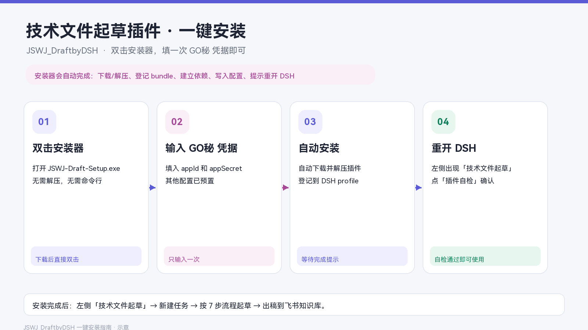
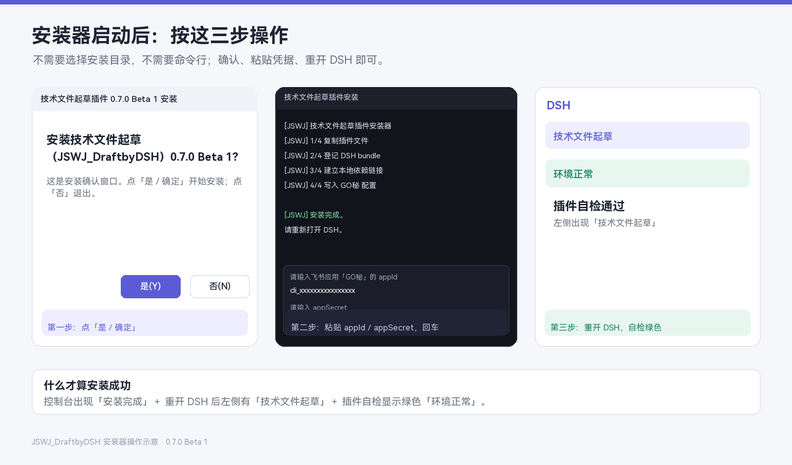
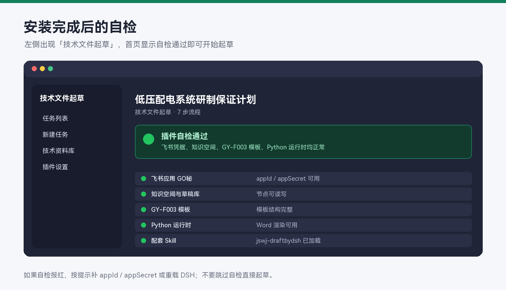
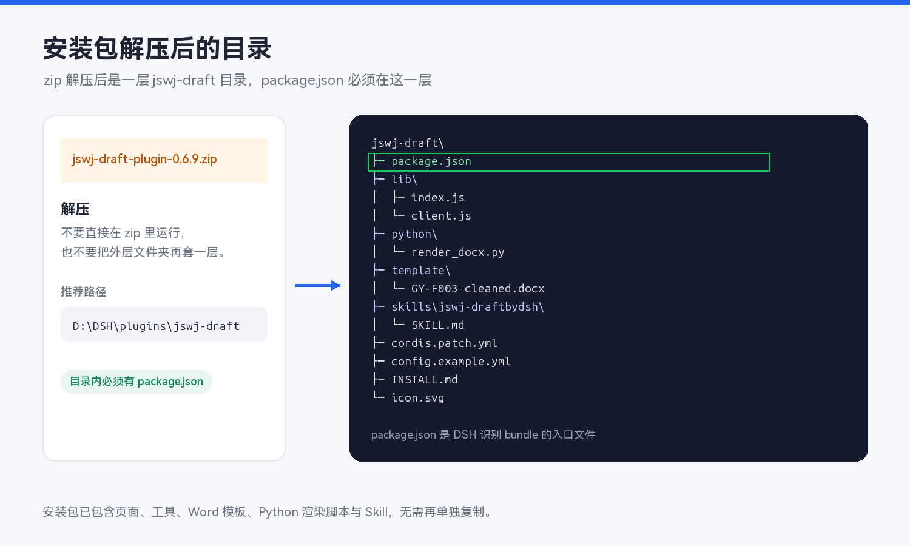
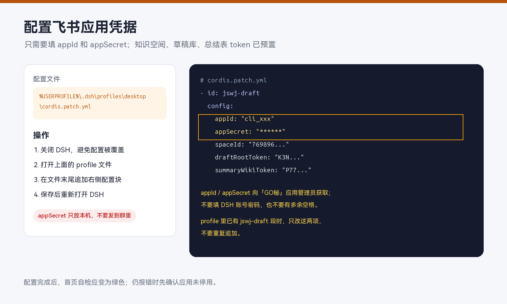

# 技术文件起草（JSWJ_DraftbyDSH）安装指南

适用版本：`0.7.0-beta.2` ｜ 一键安装 ｜ 约 2 分钟



安装包已经包含页面、工具、Word 模板、Python 渲染脚本和配套 Skill。不需要 `npm install`，也不需要手工复制 Skill。

## 先看结论：什么才算安装成功

三个条件同时满足才算成功：

1. 安装器控制台出现 `[JSWJ] 安装完成。`
2. 重新打开 DSH 后，左侧出现「技术文件起草」。
3. 打开插件，点「插件自检」，显示绿色「环境正常」。

少一个都不算完成，按后面的「错误处理」排查。

---

## 一、安装前准备

需要：

- 一台 Windows 10/11 电脑，DSH 桌面端能正常打开。
- 飞书应用「GO秘」的 `appId` 和 `appSecret`，向应用管理员获取。
- 安装器文件：`JSWJ-Draft-Setup-0.7.0-beta.2.exe`。

不需要：

- 不需要 npm。
- 不需要选择安装目录。
- 不需要手工编辑 YAML。
- 不需要管理员权限（个别公司安全策略除外）。

> `appSecret` 只写入本机 DSH profile，不会上传，也不会写进安装包。

---

## 二、一键安装步骤

### 第 1 步：下载安装器

从安装指南附件或 GitHub Release 下载：

```text
JSWJ-Draft-Setup-0.7.0-beta.2.exe
```

确认：

- 文件名是 `JSWJ-Draft-Setup-0.7.0-beta.2.exe`
- 文件大小约 1.1 MB
- 是 `.exe`，不是 `.zip`

如果下载到的是 `jswj-draft-plugin-0.7.0-beta.2.zip`，那是手动安装包，不是一键安装器。

### 第 2 步：完全退出 DSH

安装器会修改 DSH 的 profile 配置，DSH 运行时会覆盖配置，所以必须先退出。

必须做到：

- 关闭 DSH 主窗口
- 检查任务栏，不能只剩托盘图标
- 必要时在任务管理器里结束 `DeepSeek Harness`

如果没退出，安装器会提示：

```text
[JSWJ] 请先完全退出 DSH（不是最小化），再运行安装器。
```

看到这条就关掉 DSH，重新双击安装器。

### 第 3 步：双击安装器

双击：

```text
JSWJ-Draft-Setup-0.7.0-beta.2.exe
```

可能出现的系统提示：

| 现象 | 操作 |
|---|---|
| Windows SmartScreen「未知发布者」 | 点「更多信息」→「仍要运行」 |
| 用户账户控制（UAC） | 点「是」允许 |
| 安全软件拦截 | 选择「允许本次运行」；仍被拦截时用文末手动安装 |

**正常情况不会弹出“Extract to / 解压到”路径选择。**

如果弹出 `7-Zip self-extracting archive` 并让你选择解压路径，说明用的是旧安装器或错误安装器：

1. 点「Cancel」
2. 删除这个文件
3. 重新下载 `JSWJ-Draft-Setup-0.7.0-beta.2.exe`

### 第 4 步：确认安装

安装器会弹出确认窗口：

```text
技术文件起草插件 0.7.0 Beta 1 安装
安装技术文件起草（JSWJ_DraftbyDSH）0.7.0 Beta 1？
```

点击：

- **是 / 确定**：开始安装
- **否 / 取消**：退出，不修改任何文件



### 第 5 步：输入 GO秘 凭据

确认后会打开命令行窗口，标题为：

```text
技术文件起草插件安装
```

按提示输入两项：

```text
请输入飞书应用「GO秘」的 appId
```

粘贴 `appId`，例如 `cli_xxxxxxxxxxxxxxxx`，按回车。

```text
请输入 appSecret
```

粘贴 `appSecret`，按回车。

注意：

- 只粘贴值，不要带 `appId=`、引号或多余空格。
- `appSecret` 是飞书应用密钥，不是 DSH 账号密码。
- 输入窗口在本机，内容不会上传。
- 如果粘贴错了，等安装完成后重新运行安装器，或在 DSH profile 里改。

### 第 6 步：等待自动安装

不需要再点任何按钮。安装器会依次显示：

```text
[JSWJ] 1/4 复制插件文件
[JSWJ] 2/4 登记 DSH bundle
[JSWJ] 3/4 建立本地依赖链接
[JSWJ] 4/4 写入 GO秘 配置
```

这四步分别做：

| 步骤 | 做什么 |
|---|---|
| 1/4 | 把插件复制到 `%LOCALAPPDATA%\JSWJ-Draft\plugin` |
| 2/4 | 把插件登记到 DSH profile 的 bundle 列表 |
| 3/4 | 在 profile 的 `node_modules` 下建立本地依赖链接 |
| 4/4 | 把 `appId` / `appSecret` 和知识库配置写入 `cordis.patch.yml` |

### 第 7 步：确认安装完成

成功时控制台最后显示：

```text
[JSWJ] 安装完成。
[JSWJ] 插件目录：C:\Users\<用户名>\AppData\Local\JSWJ-Draft\plugin
[JSWJ] profile：C:\Users\<用户名>\.dsh\profiles\desktop
[JSWJ] 请重新打开 DSH，左侧会出现「技术文件起草」。
[JSWJ] 首次进入如提示自检，点「插件自检」；红色项按提示补凭据。
```

然后：

```text
请按任意键继续. . .
```

按任意键关闭窗口。

> 只要没看到 `[JSWJ] 安装完成。`，就不算安装成功。

### 第 8 步：重新打开 DSH

重新启动 DSH，等待左侧导航加载。

正常应出现：

```text
技术文件起草
```

如果没有出现，先看「错误处理」里的「左侧没有入口」。

### 第 9 步：插件自检

1. 打开左侧「技术文件起草」。
2. 点右上角「插件自检」。
3. 看首页状态：

| 状态 | 含义 | 操作 |
|---|---|---|
| 绿色「环境正常」 | 安装成功 | 可以新建任务 |
| 黄色「有提醒」 | 不影响使用，但有配置提醒 | 按提示处理字体/可选配置 |
| 红色「需要自检」 | 有阻断问题 | 按自检项修复，常见是凭据或网络 |



---

## 三、每一步操作对照表

| 步骤 | 你要做什么 | 成功标志 | 失败怎么办 |
|---|---|---|---|
| 1 下载 | 下载 `JSWJ-Draft-Setup-0.7.0-beta.2.exe` | 文件名、大小正确 | 重新下载，不要用 zip 代替 |
| 2 退出 DSH | 完全关闭 DSH，包括托盘 | 任务管理器没有 DSH | 结束进程后重试 |
| 3 双击 | 双击 exe；SmartScreen 选「仍要运行」 | 出现安装确认窗口 | 弹解压路径说明文件旧，重新下载 |
| 4 确认 | 点「是 / 确定」 | 出现命令行窗口 | 点「是」不是「否」 |
| 5 输入 | 粘贴 appId，回车；粘贴 appSecret，回车 | 进入 1/4 复制 | 检查是否为空、是否带引号 |
| 6 安装 | 等待，不要关窗口 | 依次出现 1/4～4/4 | 看控制台红字，按错误处理 |
| 7 完成 | 看到「安装完成」后按任意键 | 出现完成提示 | 没看到完成就重跑 |
| 8 重启 | 重新打开 DSH | 左侧有「技术文件起草」 | 查 bundle、重载、重跑安装器 |
| 9 自检 | 点「插件自检」 | 绿色「环境正常」 | 按红色项修复 |

---

## 四、错误处理

### 1. 弹出 `7-Zip self-extracting archive` / `Extract to`

原因：用了普通 7-Zip 解压模块的旧安装器。

处理：

1. 点「Cancel」
2. 删除当前 exe
3. 重新下载 `JSWJ-Draft-Setup-0.7.0-beta.2.exe`
4. 正常安装器不会问解压路径，而是直接弹安装确认

### 2. `请先完全退出 DSH`

原因：DSH 还在运行。

处理：

1. 关闭 DSH 主窗口
2. 检查任务栏托盘，右键退出
3. 任务管理器结束 `DeepSeek Harness`
4. 重新双击安装器

### 3. `未找到 DSH profile`

原因：DSH 从未启动过，或 profile 路径不是默认的 `desktop`。

处理：

1. 先启动一次 DSH，让它生成默认 profile
2. 完全退出 DSH
3. 重新运行安装器
4. 如果公司改了 profile 名，需要手动安装或指定 profile

### 4. `安装包不完整：... 没有 package.json`

原因：安装器文件损坏，或下载不完整。

处理：

1. 删除当前安装器
2. 重新下载
3. 核对文件大小约 1.1 MB
4. 不要用下载工具“只下部分”

### 5. `appId / appSecret 不能为空`

原因：直接回车，没有输入值。

处理：

1. 重新运行安装器
2. 确认复制的是飞书应用的 `appId` / `appSecret`
3. 不要带 `appId=`、引号、空格

### 6. `无法替换已有目录：...`

原因：profile 下已有同名真实目录，安装器不敢删。

处理：

1. 打开提示的路径
2. 手动删除 `node_modules\@govy\dsh-plugin-jswj-draft`
3. 重新运行安装器

### 7. 双击没反应 / 窗口一闪而过

处理：

1. 右键「以管理员身份运行」
2. 检查安全软件是否拦截
3. 把安装器放到非中文、非网络盘路径再试
4. 仍不行，用文末手动安装

### 8. 安装完成，但左侧没有「技术文件起草」

处理顺序：

1. 确认 DSH 已完全重启
2. 打开「插件管理」，确认 `@govy/dsh-plugin-jswj-draft` 已启用
3. 检查 profile `package.json` 的 `dsh.profile.bundles` 是否包含该包
4. 检查 `node_modules\@govy\dsh-plugin-jswj-draft` 是否存在
5. 重新运行安装器
6. 仍不行，看 DSH 启动日志

### 9. 自检红色

常见原因：

| 自检项 | 处理 |
|---|---|
| appId / appSecret 缺失或错误 | 重新运行安装器，或改 profile 配置 |
| 飞书应用被停用 | 找应用管理员恢复 |
| 知识空间无权限 | 给应用开通知识库权限 |
| 模板文件缺失 | 重新安装，确认 `template/GY-F003-cleaned.docx` 存在 |
| Python 不可用 | 检查 DSH 运行时；重新安装 |
| 字体缺失 | 按提示安装 HarmonyOS Sans，不阻断主流程 |

### 10. 升级后配置丢了

安装器会备份原配置：

```text
cordis.patch.yml.bak-<时间戳>
package.json.bak-<时间戳>
```

在 profile 目录找到备份，对比恢复 `jswj-draft` 配置块。

---

## 五、升级与卸载

### 升级

1. 完全退出 DSH
2. 直接运行新版安装器
3. 重新输入 `appId` / `appSecret`
4. 重开 DSH，自检

任务数据保存在：

```text
~/.dsh/jswj-tasks
```

升级不会删除任务。

### 卸载

1. 关闭 DSH
2. 在插件管理里禁用/移除 `@govy/dsh-plugin-jswj-draft`
3. 删除 `%LOCALAPPDATA%\JSWJ-Draft`
4. 删除 profile 的 `jswj-draft` 配置块
5. 任务数据按需保留或删除

---

## 六、手动安装（备用）

只有在安装器被安全软件拦截，或需要装到自定义目录时才用。

### 1. 解压

下载：

```text
jswj-draft-plugin-0.7.0-beta.2.zip
```

解压到固定目录，例如：

```text
D:\DSH\plugins\jswj-draft
```

目录里必须能看到 `package.json`。



### 2. 安装 bundle

1. 打开 DSH
2. 进入「插件管理」
3. 选择「安装本地 bundle」
4. 选择包含 `package.json` 的 `jswj-draft` 目录
5. 启用并重载 DSH

### 3. 写配置

关闭 DSH，编辑：

```text
%USERPROFILE%\.dsh\profiles\desktop\cordis.patch.yml
```

追加：

```yaml
- id: jswj-draft
  config:
    appId: "cli_xxxxxxxxxxxxxxxx"
    appSecret: "xxxxxxxxxxxxxxxxxxxxxxxxxxxxxxxx"
    spaceId: "7698962670346636559"
    draftRootToken: "K3NpwxFzribxgOkzFxaczeH7nXf"
    wikiBaseUrl: "https://govy.feishu.cn"
    summaryWikiToken: "P77ZwJyDIiIfoJkmUVccrk7mnfc"
```

只改 `appId` / `appSecret`，其他项保持预置值。



### 4. 重启并自检

重开 DSH，打开「技术文件起草」，点「插件自检」。

---

## 七、安装器实际做了什么

安装器不会改系统目录，也不会写注册表。它只做：

```text
复制插件
  → %LOCALAPPDATA%\JSWJ-Draft\plugin

登记 bundle
  → %USERPROFILE%\.dsh\profiles\desktop\package.json

建立依赖
  → node_modules\@govy\dsh-plugin-jswj-draft

写配置
  → %USERPROFILE%\.dsh\profiles\desktop\cordis.patch.yml
```

修改前会生成 `.bak-<时间戳>` 备份。

---

## 八、安全说明

- `appSecret` 只保存在本机 profile，不上传。
- 安装器不收集电脑信息。
- 安装器没有代码签名，Windows 可能提示未知发布者。
- 不要把 profile 配置文件、安装器日志或 `appSecret` 发到群里。
- 公司网络无法访问 GitHub 时，把安装器和插件包放到内网共享盘，安装步骤不变。
